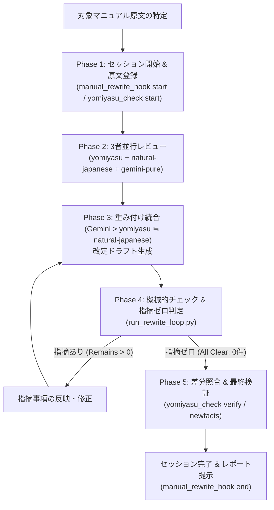

# Manual Rewriter（日本語マニュアル品質保証リライト）

本リポジトリ内のマニュアル、ユーザーガイド、仕様解説ドキュメント（`docs/`、`README.md` など）を、**「主張・事実の完全維持（IRON RULE）」** を絶対条件とし、**「マニュアルとしての理解のしやすさ・明快さ・格調高さ」** を最大化してリライト・推敲するためのスキルです。

---

## 1. 絶対原則（IRON RULE: 主張・事実の完全維持）

マニュアルの推敲・リライトにおいて、次の4原則は絶対に破ってはなりません：

1. **主張・事実・数値・前提の不増補（勝手に足さない）**
   - 元の文書に存在しない事実、数値、人名、日付、前提条件、意見、方針を絶対に書き足さない（ゼロ・ハルシネーション）。
   - 推測で仕様や挙動を補完しない。不足している情報は書き足さず、ユーザーへの確認事項として明示する。
2. **確信の度合いを変えない**
   - 推定や可能性（「〜のおそれがある」「〜と考えられる」）を断定（「〜である」）に変えない。
   - 逆に断定されている仕様を曖昧に弱めない。
3. **論理関係と比重を曲げない**
   - 条件分岐、前提条件、例外事項の論理関係（AかつB、AまたはB、AのときのみB）を厳密に保つ。
   - 主従関係や重要度の順位をすり替えない。
4. **文の働きを維持する（マニュアルの立場）**
   - 手順や仕様の説明文を、個人的な感想や宣伝文句、大げさな惹句に変えない。
   - 読者が迷わず操作・理解できる客観的・中立的かつ格調高いトーンを貫く。

---

## 2. 3者エージェント体制と役割分担

メインエージェント（Orchestrator）の指揮のもと、専門性の異なる3つの視点（Sub-Agent）を並行起動してレビュー・推敲を実施します。

```
                    ┌─────────────────────────┐
                    │  Main Agent             │
                    │  (Orchestrator)         │
                    └────────────┬────────────┘
         ┌───────────────────────┼───────────────────────┐
         ▼                       ▼                       ▼
┌──────────────────┐    ┌──────────────────┐    ┌──────────────────┐
│ Sub-Agent 1:     │    │ Sub-Agent 2:     │    │ Sub-Agent 3:     │
│ /yomiyasu        │    │ /natural-japanese│    │ gemini-pure      │
│ (意味保持・比喩排除)│   │ (禁則・新事実検査) │    │ (格調・自然な表現)│
└──────────────────┘    └──────────────────┘    └──────────────────┘
```

### ① Sub-Agent 1: `/yomiyasu` (Yomiyasu Reviewer)
- **基盤**: `skills/yomiyasu`（v2.0.0）および `yomiyasu_lint.py`, `yomiyasu_check.py`, `yomiyasu_diff.py`
- **主務**:
  - 意味保持（主張・比重・言い切りの強さ・文の働き）の点検。
  - 比喩動詞（「溶かす」「刺さる」「倒す」「握りつぶす」等）の徹底排除。
  - マニュアルにふさわしくない過剰な前置き・結び定型句の削除。
  - ラベル＋コロン形式の箇条書きの自然な文への平文化。
  - `yomiyasu_lint.py --doc-type manual` による機械的検証。

### ② Sub-Agent 2: `/natural-japanese` (Natural Japanese Reviewer)
- **基盤**: `skills/natural-japanese` および `lint.py`, `newfacts.py`, `outline.py`, `terms.py`
- **主務**:
  - LLM常套句カタログ・禁止語（「〜と言えるでしょう」「本質」「極めて」「まさに」等）の検出。
  - 翻訳調、過剰な受動態、不自然な二重否定の検出。
  - 読点の多用（息継ぎ読点）、過剰な太字の検出。
  - `newfacts.py` による、原文にない新事実・未確認数値・固有名詞の完全検出。

### ③ Sub-Agent 3: `gemini-pure` (Gemini Pure Stylist)
- **基盤**: 外部制約スキル・スクリプトを一切適用しない、素のGemini。
- **主務**:
  - ルールに縛られて硬直・断片化しやすい日本語を、人間が書いた最も自然で格調高い文章へリライト。
  - マニュアル読者にとっての「読みやすさ」「理解のしやすさ」「文章の流れの心地よさ」の最大化。
  - 正確な助詞配置と主述の結びつき、文と文のスムーズな論理展開の提案。

### Sub-Agentの起動方式と `disable-model-invocation: true` について
- `yomiyasu` および `natural-japanese` には **`disable-model-invocation: true`** が設定されています。これにより、モデルが日常会話や通常の開発作業中に自律的・暗黙的にこれらのスキルを単体起動することが完全に防止されます。
- `manual-rewriter` から各Sub-Agentを呼び出す際は、モデルの暗黙的な自動選択に頼るのではなく、次の方法で確実に発火・適用します：
  1. **明示的なスキルファイル参照**: `invoke_subagent` 呼び出し時、プロンプト内で各スキルの指示書（`.agents/skills/yomiyasu/SKILL.md` や `.agents/skills/natural-japanese/SKILL.md`）を読み込ませてその規則に従わせる。
  2. **スラッシュコマンドによる明示実行**: `/yomiyasu` や `/natural-japanese` を明示的に指定して起動する（明示的コマンド実行は `disable-model-invocation: true` でも発火します）。
  3. **機械的検査スクリプトの直接実行**: `run_rewrite_loop.py`（内部で `yomiyasu_lint.py`, `lint.py`, `newfacts.py` を呼び出し）によるルールチェックはコマンド実行であるため、モデル呼び出し制限の影響を一切受けずに 100% 確実に動作します。

---

## 3. 日本語表現の優先順位と重み付け統合

メインエージェントは各Sub-Agentの出力を収集し、次の優先順位で統合します：

$$\text{Gemini} \quad > \quad \text{yomiyasu} \quad \fallingdotseq \quad \text{natural-japanese}$$

### 統合ルール
1. **攻めの表現・語順・文体（表現の主軸）: Gemini を最優先**
   - 採用する文章の基本骨格は **Gemini の提案をベース** とする。
   - 機械的なルール適用のみでは失われがちな「マニュアルとしての自然な流れと読みやすさ・格調」を確保する。
2. **守りの安全性・事実改変防止・AI臭さ排除（安全弁・フィルター）: yomiyasu ≒ natural-japanese を厳格適用**
   - Geminiの提案に対して、yomiyasu と natural-japanese の指摘をチェックフィルターとして重ねる。
   - Geminiの表現に「元にないニュアンスの付加（new facts）」「比喩動詞」「AI手癖フレーズ」が含まれている場合は、yomiyasu / natural-japanese の指摘に従って該当箇所を削ぎ落とし、修正する。

---

## 4. 品質保証反復ループ（Quality Assurance Loop）の手順



### Phase 1: セッション開始 & 原文登録
1. 対象ファイル（例: `docs/spec.md`）のバックアップとセッション登録を行う：
   ```powershell
   python .agents/skills/manual-rewriter/scripts/manual_rewrite_hook.py start docs/spec.md
   ```
2. 原文の主張、数値、前提、制約をリスト化し、IRON RULEの遵守対象を確定する。

### Phase 2: 3者による並行レビュー・提案
1. **yomiyasu によるレビュー**:
   - `python .agents/skills/yomiyasu/scripts/yomiyasu_lint.py <file> --doc-type manual --reader informed`
   - 指摘事項と推敲案を抽出。
2. **natural-japanese によるレビュー**:
   - `python .agents/skills/natural-japanese/scripts/lint.py <file> --genre tech`
   - 指摘事項と改善案を抽出。
3. **gemini-pure によるリライト案提示**:
   - 原文の意味・事実を完全維持した上で、マニュアルとして最も直感的・明快・格調高い日本語リライト案を提示。

### Phase 3: 重み付け統合（ドラフト作成）
- Geminiの流麗なリライト案を主軸とし、yomiyasu / natural-japanese の指摘（比喩動詞の排除、新事実の除去、常套句の平文化）を反映した統合ドラフトを作成する。

### Phase 4: 指摘ゼロ反復品質保証ループ
1. 統合スクリプトを実行し、機械的指摘および新事実を検証する：
   ```powershell
   python .agents/skills/manual-rewriter/scripts/run_rewrite_loop.py <original_file> <draft_file> --doc-type manual
   ```
2. **判定基準**:
   - `yomiyasu_lint`: warn / error 指摘が 0 件
   - `natural-japanese lint`: warn / critical 指摘が 0 件
   - `newfacts`: 新事実・未確認数値の付加が 0 件
3. **反復**:
   - 指摘が残っている場合は、該当箇所を再修正して Phase 3〜4 を反復する。
   - すべての指摘が解消され、`All Clear: [PASS]` になるまでループを継続する。

### Phase 5: 差分照合 & 完了
1. 最終成果物を対象ファイルに反映する。
2. 変更前後の差分（Before / After）と推敲理由をレポートする。
3. セッションを終了する：
   ```powershell
   python .agents/skills/manual-rewriter/scripts/manual_rewrite_hook.py end
   ```

---

## 5. マニュアル作成時のみ機能するライフサイクルフック（Hooks）

日常のC#コード実装、ビルド、テスト、コミット作業を一切妨げないよう、フックは次のように制御されています：

- **平常時（マニュアルリライト非アクティブ）**:
  - フックスクリプトはセッションの不在を判定し、1ミリ秒で即座に `exit 0` して何もしません。日常の開発にオーバーヘッドや警告を出しません。
- **マニュアルリライト作業中（アクティブ時）**:
  - `manual_rewrite_hook.py start <file>` を実行するとセッションが有効化されます。
  - ファイル保存・編集時に、未登録の新事実や数値の無断付加（`newfacts`）をリアルタイムに検知し、ガードします。
  - リライトが完了して `manual_rewrite_hook.py end` を実行すると監視が解除されます。
