# プロジェクトの計画と設定

## はじめに

GitHub Projects の Issue を、工数・担当者・先行関係を持つ計画として編集する Windows アプリです。毎週、実績工数と見込み残存工数を見直し、日程と負荷を確認してから GitHub に反映します。担当者の負荷は自動で平準化しません。

計画の編集はこの PC に保存され、**発行**の確認画面で **発行する**を押すまで GitHub に書き込みません。

最初は [起動と接続](#起動と接続) → [プロジェクトを開く](#プロジェクトを開く)へ進んでください。毎週は [毎週の更新](#毎週の更新) → [最新の情報に更新](#最新の情報に更新) → [発行と競合の確認](#発行と競合の確認)の順で作業します。

このマニュアルは、タイトルバーの **ヘルプ** または **F1** で画像付きで開けます。画面の例は同梱版と同じアプリに評価用の第2027.04版を表示したもので、アカウント名やタスクは例です。

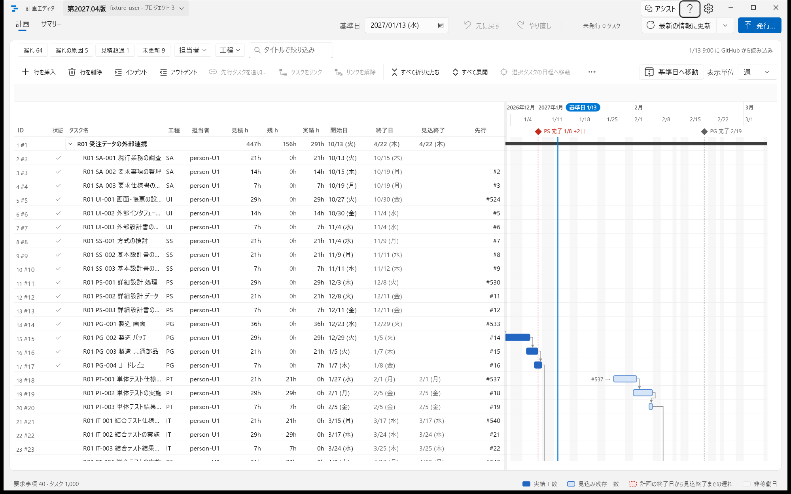

## 起動と接続

1. 配布 ZIP を[社内配布版の使い方](使い方.md)に従って展開し、`GhProjectsBoards.App.exe` を起動します。`manual/images` を含むフォルダー全体を保持してください。
2. GitHub CLI (`gh.exe`) で利用するアカウントの認証を済ませます。アプリは gh の保存済みアカウントを使います。
3. **gh.exe** のパスと **接続先**（通常は `github.com`）を確認し、**接続**を押します。

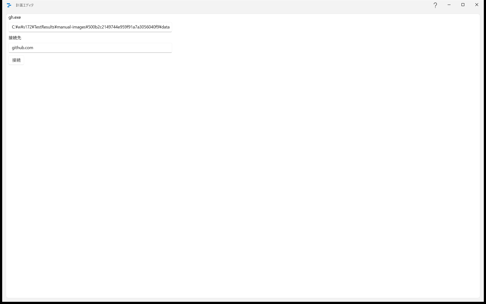

## プロジェクトを開く

1. **組織**で組織（または個人）を選び、必要なら **リポジトリ**で絞り込んでから、**プロジェクト**の一覧で **第2027.04版**を選びます。名前や番号で探すときは検索欄に入力します。終了済みのプロジェクトは **終了済みも表示** をオンにしたときだけ表示されます。最近開いたプロジェクトは一覧の上から直接開けます。URL を使う場合は **URLで開く**を展開します。
2. 読み込みが終わったら、タイトルバーのプロジェクト名と、画面下の要求事項・タスク件数を確認します。
3. **設定**の **期間**と **工程**で、初回に取り込んだ開始日・終了日とマイルストーンの対応を確認します。空欄や違いがあれば設定します。

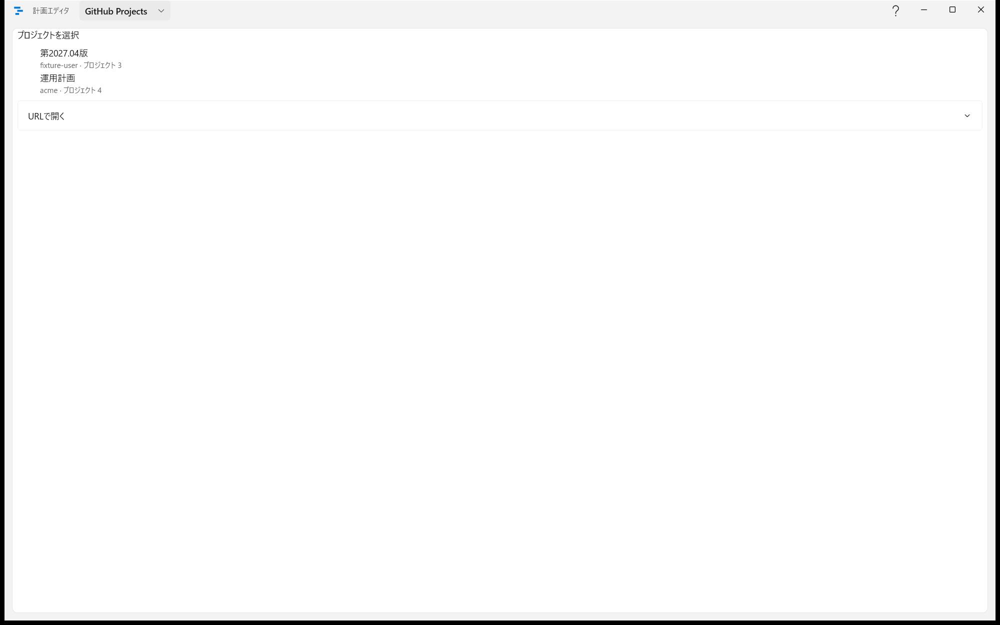

初めてプロジェクトを取り込むときだけ、開始日は Issue の最も早い開始日、終了日はマイルストーンの最も遅い期日（期日がなければ Issue の最も遅い終了日）から設定し、工程名と大文字・小文字を区別せずに一致するか、工程名の直後が文字・数字以外のマイルストーンが一つだけあれば対応させます（日付の逆転や候補の重複は未設定のままです）。その後は変更・消去・書き出し・読み込みができ、更新・再起動・GitHub の状態に戻す操作で設定し直すことはありません。

最初は GitHub の日付をそのまま表示します。更新や基準日の変更で日付が動くことはありません。日付が動くのは、そのタスクを自分で編集したときと、GitHub 側で日付が変わったときだけです。

開いているプロジェクト名をクリックすると、最近開いた順に並んだ登録済みのプロジェクトを切り替えられます。一覧のチェックは現在開いているプロジェクトだけに付きます。**プロジェクトを開く…** と **接続…** もここにあります。設定はタイトルバーの歯車から開きます。

## 画面の見方

上から、プロジェクト名と **ヘルプ**・**設定**のタイトルバー、**計画**・**サマリー**の切り替えと **基準日**・**元に戻す**・**やり直し**・未発行件数・**最新の情報に更新**・**発行…**のコマンド行、計画シートとガント、ステータスバーが並びます。

### シートとガント

工程列はタスク名の直後にあります。選択肢の名前を入力・貼り付け・下へコピーできます。空欄にするには Delete を使います。未設定の工程列は編集できません。

担当者が複数いるタスクは、先頭の名前と残りの人数 ` +N` を表示します。通常のタスク行では、名前が列幅に収まらないときは省略記号で短縮し、残りの人数は常に表示します。1人の場合も長い名前は省略し、未割り当ては空欄です。ツールチップでは全員の名前を確認でき、編集・コピーには全員分の入力値を使います。

要求事項（子タスクを持つ行）はタスク名だけ編集できます。工数と開始日・終了日は子タスクから集計されます。担当者・先行などは GitHub にある値だけを表示し、編集・発行の対象にはなりません。選択すると編集できない理由が表示されます。

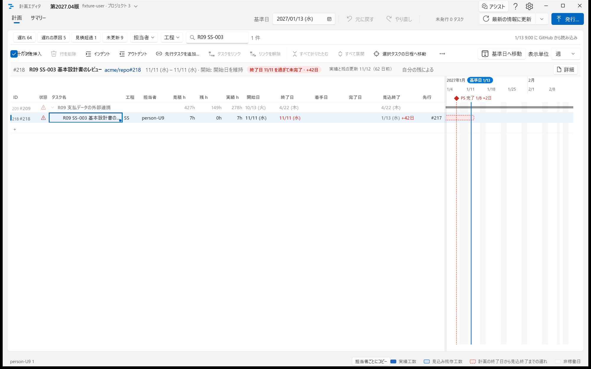

表の直上の説明行には、選択したタスクの番号（`#407` などの Issue 番号）・名前、開始と終了の理由、遅れの表示、右端に Issue へのリンクが出ます。開始の理由には「開始: #193 の終了後」のように先行タスクの番号などを表示します。終了の理由は、着手済みなら実績工数と見込み残存工数の合計を使い切る日として「終了: 開始から 24h」、未着手なら「終了: 開始から 40h」、保持する指定日なら「終了: 指定」です。完了・要求事項・工数0のタスクなど、説明が当てはまらない場合は終了の理由を表示しません。選んだタスクの遅れが後続に及ぶときは「この遅れで後続 12 タスクが予定より遅れ」と **後続を表示** が出て、押すとその後続だけに絞り込まれます。先行タスクの遅れで遅れているときは「先行 #193 の遅れによる」と **#193 へ移動** が出て、押すとその行を選びます。この説明行の上には、操作を拒否した理由も表示します。行やセルを選び直すと消えます。

- 期限超過は輪郭だけの赤いラベルで「終了日 11/10 を過ぎて未完了」または「開始日 11/9 を過ぎて未着手」と表示します。見込終了も後ろへ動いていれば「· +2日」のように添えます。
- 予定より遅れは輪郭だけの黄色の⚠で示し、ラベルに「見込終了 12/3 (金) · 12/1 から +2日」、ツールチップに原因（自分の残による／先行 #193 の遅れによる）を表示します。
- 要求事項では「配下: 期限超過 1 · 予定より遅れ 17」のように0でない件数を表示します。その行の終了日も後ろへ動いた場合は、記号の種類に対応した薄塗りまたは輪郭のラベルを添えます。

未選択時は説明行の左側は空で、右側にプロジェクト全体の期限超過・予定より遅れ・遅れの原因・見積超過の0でない件数をボタンで示します。要求事項を重複して数えません。ボタンを押すとその集まりだけに絞り込まれ、要求事項の行は薄い文字で文脈として残ります。件数のチップの × で解除します。

日付は `10/14 (水)` の形で表示し、編集するときは `2026-10-14` の形で入力します（`10月14日` や全角の数字も受け付けます）。計算された日付は薄い文字、入力した日付は濃い文字です。**状態**の列は、その行のいまの状態を1つの記号で示します。当てはまる状態が複数あるときは、次の順で強いものだけを表示し、ツールチップと読み上げでは当てはまる状態をすべて伝えます。色だけでなく形と文字でも区別でき、白黒で印刷しても意味は変わりません。

| 見た目 | 意味 |
| --- | --- |
| 赤い輪郭の丸に ! | 発行に失敗、または入力エラー。ツールチップに理由を表示します。 |
| 赤い輪郭の ⇄ | 競合。同じ項目がこの PC と GitHub の両方で変わっています。競合したセルは赤い枠で示します。 |
| 赤い輪郭の ⚠ | 遅れ。開始日または終了日が基準日を過ぎています。過ぎた日付はセルでも赤い文字になります。 |
| 黄土色の輪郭の ⚠ | 遅れ。見込終了が予定の終了日より後ろになっています。 |
| 灰色の ⊘ | 中止、またはこの版から外す指定（未発行）。タスク名は薄い文字になります。 |
| 灰色の ✓ | 完了。 |
| 記号なし | 上記の状態に該当しません。 |

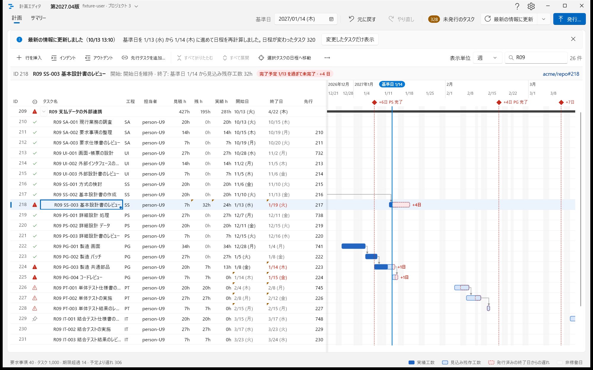

**遅れ**の記号は、色ではなく日付の文字と「+N日」、ツールチップで2つの場合を区別します。

- **赤い輪郭の⚠（日付が過ぎた遅れ）**：予定の終了日が基準日より前なのに未完了のタスク、または予定の開始日が基準日より前なのに未完了で実績工数が未入力または 0h のタスクです。基準日当日の予定は含めません。ツールチップは「終了日 12/18 を過ぎて未完了 · +21日」「開始日 1/11 を過ぎて未着手」のように表示します。
- **黄土色の輪郭の⚠（見込終了の遅れ）**：日付は過ぎていませんが、見込終了が予定の終了日より後ろになったタスクです。ツールチップは「見込終了 1/19 · +2日（先行 #768 の遅れによる）」のように、遅れの原因（自分の残による／先行タスクの遅れによる）を添えます。

**見積超過**は、実績工数と見込み残存工数の合計が見積工数を超えたタスクです。状態の列ではなく、**見積 h** のセルに「16h +16h」のように超過分を黄土色の文字で添えます。ツールチップは「見積超過: 見込 32h（見積 16h）」です。期限の遅れと重なっても、状態の列は遅れの記号のままです。

見込み残存工数が 0 でも Issue が閉じていない「残 0・未完了」には、シート上で記号も件数も出しません。完了として閉じるかどうかは Issue の状態で判断します。

遅れと見積超過の印は、設定で1つずつ非表示にできます（既定はすべて表示）。非表示にしても、件数・絞り込み・遅れの判定は変わりません。

要求事項の行は、折りたたんでいても配下のいちばん強い遅れの記号（赤または黄土色）を示し、ツールチップに「配下: 遅れ 18 · 見積超過 1」のように0でない件数を表示します。見積のない子タスクがあるときは、見積 h・残 h のセルに件数のバッジを添え、「見積のないタスク N 件を除く」と伝えます。終了日を赤い文字にするのは、子タスクを持たないタスクでその終了日が基準日を過ぎている場合だけです。条件が外れた場合は、日付の文字が変わらなくても通常の文字色に戻ります。要求事項の工数と日付は集計値として薄い文字で表示します。

ガントは実績工数を濃く、残りを薄く、要求事項を括弧形のバーで示します。見込終了が予定の終了日より後ろになると、その翌日から見込終了までを赤い破線で示します。日付が過ぎた遅れの行だけ、この区間を薄い赤で塗り、日・週では「+N日」を添えます。見込終了だけが遅れた行は破線のみです。月・全期間では数値ラベルを省略し、ツールチップと選択行の説明で確認できます。N はプロジェクトカレンダーの稼働日数で、土日・祝日・会社休日を除きます。先行タスクが画面の外にあって行が見えないときは、線を引かずに後続のバーの直前に「#1204 →」と置き、ツールチップに「先行 #1204（表示されていません）」と表示します。マイルストーンの ◆ は灰色で示し、目標日を過ぎても工程が終わっていないときは赤に、完了見込が目標日より遅ければ「+N日」を添えます。基準日はアクセント色の縦線と「基準日 1/13」の札で示します。

入力した未発行の値は薄い地と角の印、行の左端のオレンジ色の細い帯（3 px）で示し、自分の編集で後続に波及した開始日・終了日は角の印だけで示します。要求事項の集計工数には未発行の印を付けません。タイトルバー下の「未発行 N タスク」にも同じオレンジ色の帯が付きます。

初期表示では ID・状態・タスク名・工程・担当者・見積 h・残 h・実績 h・開始日・終了日・見込終了・先行の12列を表示します。ウィンドウ幅が 約1,340実効ピクセル 以上なら横スクロールなしで収まります。狭いウィンドウではガントを最低320実効ピクセル確保し、表を横スクロールします。コマンドバーの「…」にある **表示列**から先行・ステータスなどを追加できます。**見込終了**は読み取り専用の列で、先行関係と見込み残存工数から計算した終了の見込みを薄い文字で示します。予定の終了日より後ろになる場合は、その差を稼働日数で赤い「+N日」として添えます。見込みを出せないタスク（完了・日付のないタスク・工数のないタスク）は空欄です。表とガントの境界をドラッグするか、境界にフォーカスして左右キーを押すと幅を変えられます。列の幅は、見出しの右端をドラッグして変えられます。右端をダブルクリックすると、表示中の行に合わせた幅になります。**基準日**で計画の基準日を選びます。ガントは **日／週／月／全期間** を切り替えられ、**全期間**は絞り込みや折りたたみで隠れたタスクを含む日程全体と基準日を表示します。左右に余白を確保し、ウィンドウや境界の幅を変えると再び全体を収めます。**選択タスクの日程へ移動**で選択行の開始日へ移動します。開始日がなく終了日だけなら終了日へ移動します。縦スクロールだけでは表示日付は変わりません。横スクロールは表と独立し、バーのドラッグ編集はありません。**表示単位**を日・週・月に切り替えると、選択行の開始日（開始日がなければ終了日、日付のある選択行がなければ基準日）が左から約4分の1の位置に来ます。日・週・月では、選択や編集だけでは表示日付を移動しません。**サマリー**で工程と期間ごとの負荷を確認できます。

画面下部のステータスバーには要求事項とタスクの件数、0でない期限超過・予定より遅れ・遅れの原因・見積超過の件数が表示されます。遅れの件数はボタンで、押すとその集まりだけに絞り込まれます。「計画」のときだけ、右側に実績工数・見込み残存工数・予定の終了日から見込終了までの遅れ・非稼働日の凡例が出ます。件数は他の画面でも確認できます。

ガント上の横ホイール、または Shift を押しながらのホイール操作は、行位置を保って表示日付を左右に動かします。Shift とホイール下向きで後の日付、上向きで前の日付へ移動します。通常の縦ホイールは行を上下に動かし、表の横位置は変わりません。

## 毎週の更新

1. 対象のプロジェクトと **基準日**を確認します。基準日は前回の取得日か、手動で選んだ日です。起動しただけでは今日に変わりません。
2. 更新するタスクを探し、**実績 h** にこれまでの累計、**残 h** に現在見込む残りの工数を、単位を付けずに入力します。たとえば累計が 24h、残りが 16h なら `24` と `16` です。**見積 h** は当初の値として保持します。
3. 必要なら日付と先行タスクを見直します。説明行とガントで、開始・終了の根拠と後続への影響を確認します。
4. **サマリー**で工程の完了見込と担当者の負荷を確認します。[最新の情報に更新](#最新の情報に更新)で他の人の変更を取り込んでから、[発行](#発行と競合の確認)します。

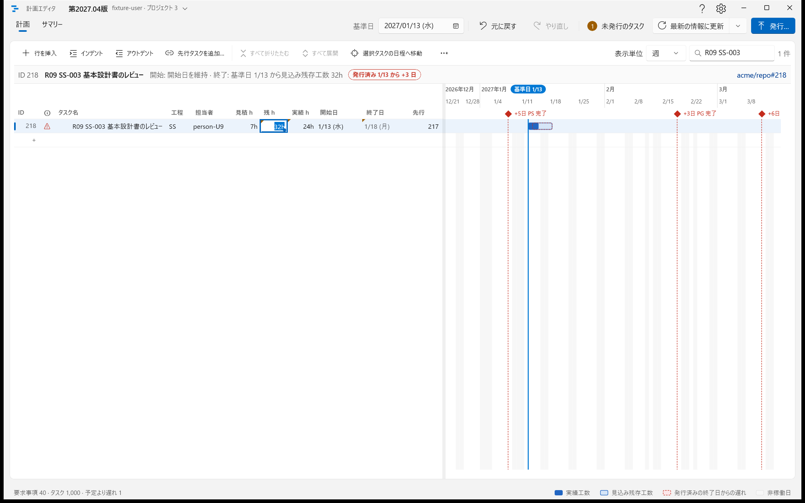

### 入力と取り消し

セルを選び、文字入力または F2 で編集します。Enter で確定して下へ、Tab で右へ移動します。日本語の変換確定 Enter はセルを確定しません。次の Enter でセルを確定します。Escape は入力を取り消します。

日本語 IME を入れたまま入力できます。全角の英数字と記号は半角に直してから列ごとの規則で読み取ります（`８`、`１ｄ`、`ｐｇ`、`１６` など）。`＃` は `#` として扱います。担当者のログインだけは半角のまま入力します。タスク名などの文字列は入力したまま保存します。

Shift を押しながらクリック・矢印、またはドラッグで範囲を選びます。PageDown / PageUp は表示中の行数ぶん選択を移動し、画面も同じだけスクロールします（Shift を押すと範囲を広げます）。Ctrl+C / Ctrl+V でコピー・貼り付け、Ctrl+D で単一セルには直前の表示行の同じ列からコピー（先頭行、またはコピー元が編集不可の場合は何もしません）、範囲選択時は先頭の値を下へコピー、Delete でクリアします。選択セルの右下のハンドルも上下へコピーできます。Ctrl+Z / Ctrl+Y は操作単位で元に戻す・やり直すです。上部の **元に戻す**／**やり直し** は、それぞれの履歴がないときは無効になります。表内のショートカットや設定の変更後も履歴に合わせて切り替わります。

Delete はタスク名を消しません。タスク名を含む範囲で Delete を押すと、ほかのセルだけがクリアされ、「タスク名は消せません。行ごと消すときは 行を削除」と表示します。計算して表示する列（見込終了）や、このプロジェクトで編集できない列（割り当てていない工程など）も消えず、その隣の編集できるセルはクリアされます。タスク名だけを選んで Delete を押したときは何も変わりません。行そのものを消すときは、ID をクリックするか Shift+Space で行全体を選び、Delete を押します（**行を削除** と同じ動きです）。選択した行に発行済みの Issue があるときは何も消さず、「GitHub の Issue は削除できません（#17）。完了・中止・この版から外す を使ってください」と表示します。案内は次に行やセルを選ぶと消えます。

- 編集中でないセルから Ctrl+F でタスク名の絞り込みへ移動します。Escape で絞り込み文字を残して元のセルへ戻ります（その行が非表示になった場合は現在の表示範囲の選択セルへ戻ります）。

行やセルを右クリックすると（キーボードでは Shift+F10 かメニューキー）**行の操作** が開きます。セルから開いたときは先頭に **コピー** と **貼り付け** があり、Ctrl+C・Ctrl+V と同じく選択中のセルに働きます。入力中のセルでは、文字のためのメニューが開きます。**行を削除**（Ctrl+-）のほか、**完了にする**、**中止にする**、**この版から外す**、**未完了に戻す** があります。**行を削除** と4つの状態コマンドは **その他のオプション**（…）にも並び、状態・理由・ショートカットはどちらも同じです。要求事項の行を選ぶと、その配下のタスクにもまとめて適用します。適用できない行があるときは「3行を除外します（未発行の行です）」のように、残す行とその理由をツールチップに示します。まったく適用できないときは、その理由を添えて選べない状態になります。更新する権限がない Issue の行は「この Issue を更新する権限がありません」と表示し、その行には適用しません。

**完了にする** は Issue を完了として閉じます。発行するまでは、その行に「完了にする」の札が付き、残 h と終了日は「完了にする を発行すると確定します（未発行）」と表示します。**中止にする** は完了ではなく閉じ、行は淡色で取り消し線付き、「中止にする」の札が付きます。**この版から外す** はプロジェクトからアーカイブし、Issue とフィールドの値は GitHub に残ります。**未完了に戻す** は閉じた Issue を再オープンし、日付と残の入力が戻ります。実行すると、表の上に「完了にする（未発行）」のように操作名と未発行であることを示す文が出ます。**元に戻す**／**やり直し**（Ctrl+Z / Ctrl+Y）や、行・セルの選び直しで消えます。発行するまでは「完了しました」のような過去の結果は表示しません。

**発行…** の画面では、これらの操作を「GitHub: Issue を完了として閉じます」のように日本語で示します。ほかの変更と同じく、行ごとに発行され、失敗した行だけが理由付きで残ります。
- F6 / Shift+F6 でシートの選択セルと上部のコマンド行を行き来します。

要求事項の親行から子タスクを折りたたみ・展開できます。親行のタイトルセルを選択した状態では Ctrl+← / Ctrl+→ でも操作できます。**すべて折りたたむ**で版全体を見渡し、**すべて展開**で詳細へ戻ります。タイトルで絞り込む間は、折りたたんだ子も一致すれば表示します。この間、**すべて折りたたむ**／**すべて展開** は無効になり、ツールチップと読み上げ用の説明に「絞り込み中は折りたためません」と表示します。「…」内でも同じ説明を確認でき、無効なコマンドにもキーボードでフォーカスできます。絞り込みを解除するとこの説明は消えます。絞り込みを解除すると元の折りたたみ状態に戻り、選択行が隠れると表示されている親へ移ります。入力が不正なときや日本語変換中は、入力を直すか確定してから切り替えます。

ID 列には、GitHub と同じ Issue 番号（`#407`）を表示します。プロジェクトに複数のリポジトリの Issue があるときは `api#407` のようにリポジトリ名を付けます。まだ発行していない行は「新1」「新2」…と表示し、発行すると Issue 番号に変わります。行を挿入・移動・削除しても、発行済みのタスクの番号は変わりません。ID 欄の左の小さな数字は行の位置で、行を探す目安です（先行タスクの指定には使いません）。

先行タスクは、この番号で指定します。`524` と `#524` はどちらも Issue 524 の行を指し、`api#524` のようにリポジトリ名を付けることも、まだ発行していない行を `新2` で指すこともできます。全角（`＃５２４`、`新２`）でも同じです。この版にない番号や、複数のリポジトリにあって決められない番号は拒否し、その番号や候補を知らせます。先行のセルをコピーして別の行に貼り付けても、同じタスクを指します。**先行タスクを追加…** では、タスク名・番号・担当者・要求事項で検索して追加できます。候補は1行に「#524 SS-003 設計 担当者 · 終了 1/12 (火)」の形で並び、同じ要求事項で一つ前の工程のタスクが先頭に来ます。要求事項の行は候補に出ません。既存の先行タスクは計画外のものも保持され、追加は **元に戻す**で一操作ずつ取り消せます。

続けて行うタスクは、行の範囲を選んで **タスクをリンク**（Ctrl+F2）を押すと、上から順に前のタスクを先行タスクにします。要求事項の行を選ぶとその子タスクすべてが対象です。版全体を選ぶと、要求事項ごとに子タスクを順につなぎ、別の要求事項のタスクとはつなぎません。既存の先行タスクは残ります。**リンクを解除**（Ctrl+Shift+F2）は、選んだタスクどうしのリンクを外します。1行だけ選んだときは、その行の先行・後続のリンクをすべて外します（計画外の先行タスクは残ります）。どちらも **元に戻す**で一度に取り消せます。絞り込み中は使えません。

末尾の空行に入力するか **行を挿入** でタスクを追加します。挿入後は新しい行のタスク名に入力できます。**インデント**／**アウトデント** で親子関係を変えます。先行タスクのリンクが新しい親子関係と矛盾するときはインデントを拒否し、「#17 は #16 の後に始まるため、#17 を #16 の下にインデントできません。先にリンクを解除してください。」のように、断った操作・理由・解除するリンクを示します。案内は次に行やセルを選ぶと消えます。親の工数と日程は子から集計され、最後の子をアウトデントすると元の親の工数を再び編集できます。

間違えて挿入した行は、その行を選んで **行を削除**（Ctrl+-）で消します。子タスクがあるときはまとめて消え、**元に戻す** 1回で戻ります。発行済みの Issue がある行は消せません。そのときは「GitHub の Issue は削除できません（#17）。完了・中止・この版から外す を使ってください」と表示されるので、GitHub 側の操作で外します。

タスク名が空のままの発行されていない行は、発行しても作られません。その行のタスク名に赤い枠が付き、シートの上に「タイトル未入力: 新2」と表示します。入力するか、**行を削除** で行ごと消します。**発行…** の画面では「タイトルのない新しい行 1 件は発行しません」と表示し、**行へ移動** でその行のタスク名へ移って入力するか、**行を削除** で消します。この行を親にした子タスクの親子関係や、この行を指す先行タスクは保留になり、ほかの変更はそのまま発行できます。

### 日付を入力するとき

入力した開始日は計画の開始日になり、先行タスクがどれだけ早く終わってもそれより前には動きません。終了日を入力すると、その編集ではそのタスクの終了日が入力した日のまま残り、後続タスクがそこから計算し直されます。後でそのタスクの工数・開始日・先行タスクを編集すると、終了日も計算し直されます。終了日を消すと自動計算に戻ります。先行タスクは Issue 番号（例: `19` または `#19`）で指定します。日付は `2026-10-14`、`2026/10/14`、`10/14` のほか、`10月14日`、全角の数字、IME が `/` の代わりに入れる `・`（例: `２・１０`）でも入力できます。年を省略した日付は基準日に最も近い年になります。

### 工数の用語と完了

| 意味 | 正式な名称 | 表の短い見出し |
| --- | --- | --- |
| 当初の見積もり | 見積工数 | 見積 h |
| これまでに使った工数 | 実績工数 | 実績 h |
| 現時点で見込む残りの工数 | 見込み残存工数 | 残 h |
| 実績工数＋見込み残存工数 | 見込工数 | 見込 h（該当する列がある場合） |
| 見込工数−見積工数 | 差異 | 差異 h（該当する列がある場合） |

単位は h です。表示値は「16h」、入力欄には「16」のように数値を入力します。表示と同じ `8h` の形でも入力でき、`1d` は 1日＝8時間として扱います。全角の数字も使えます。表の短い見出し以外では正式な名称で案内します。

見積工数は当初の工数です。超過しても見積工数を変えず、見込み残存工数を見直します。見込み残存工数が空欄なら見積工数−実績工数（最低0）を薄い計算値として表示し、入力するまで空欄のまま保持します。この計算値は発行しません。見込工数は実績工数＋見込み残存工数、差異は見込工数−見積工数です。未完了で見込工数が見積工数を超えると、見積 h のセルに「16h +16h」のように超過分を黄土色で添えます。

着手済みタスクの予定終了日は、開始日から実績工数と見込み残存工数を使い切る日として計算します。基準日より前になることもあり、そのときは赤い⚠（日付が過ぎた遅れ）が付きます。先へ動かすには終了日を入力するか、見込み残存工数を見直します。見込終了（予定ではなく見込み）は、開始日と基準日の遅い方から見込み残存工数を割り当てて計算します。正の見積工数または実績工数があるタスクで見込み残存工数が0でも完了にはならず、「残 0・未完了」と表示されますが、シートには記号を出しません。工数0のマイルストーンは従来どおりです。

Issue を閉じると完了です。見込み残存工数は0、終了日はクローズした日（ローカル日付）になります。見込み残存工数0や開始日・終了日などの自動計算値は、対応する列を割り当てていない場合も表示しますが、未発行の変更や発行対象にはなりません。開始日がクローズ日より後なら、開始日もクローズ日に補正します。完了したタスクの見込み残存工数と終了日は編集・貼り付け・フィル・クリアできず、選択行に「完了したタスクは Issue のクローズで確定します（編集不可）」と表示します。見積工数・実績工数・タイトルなどは引き続き編集できます。GitHub の列と異なる値は角の未発行マーカーで示し、次の発行で反映します。再オープン後に最新の情報に更新すると、再び未完了として表示します。

見込み残存工数の計算値をそのまま入力値として採用するには、セルを編集状態にして Enter・Tab、または別のセルへ移動して確定します。同じ数値でも明示した見込み残存工数として保存され、その後に実績工数を変更しても維持されます。Escape は取り消し、セルを選択しただけでは変更しません。

## 最新の情報に更新

1. **最新の情報に更新**を押します。プロジェクト全体の変更を取得し、この PC の未発行の編集と合わせます。
2. 結果バーの **基準日** を確認します。成功すると基準日は取得した当日になります。手動で過去の日を選んでいた場合も変わります。日付は変わりません。
3. 結果バーには更新した時刻が出ます。更新で日付が動くことはありません。見つかった遅れの件数（期限超過・予定より遅れ・遅れの原因・見積超過）は下の状態バーで確認します。
4. 遅れの原因があるときは **遅れの原因を表示**で、自分の残が原因で遅れているタスクだけに絞り込めます。絞り込みは、件数のチップの × か、タイトルの絞り込みを消すと解除できます。
5. GitHub で Issue が追加されていると、結果バーに **GitHub で追加された Issue** と番号・タイトルが出ます。**追加された Issue を表示**で絞り込めます。親のある Issue は、その親の最後の子タスクの下に置かれます（並び順の未発行の変更として次の発行で GitHub に反映します）。見積がまだない子タスクがある要求事項は、見積 h・残 h に分かっている分の合計と、その左に小さな **未入力 N**（見積のないタスクの数）を表示します。

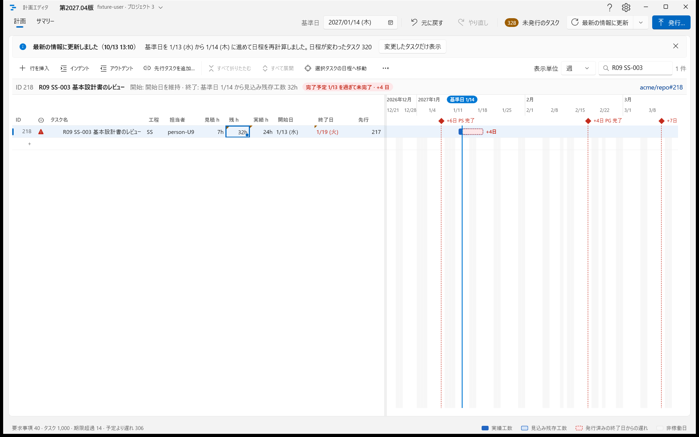

**最新の情報に更新**で GitHub の変更を取り込みます。同じセルを両側で変更した場合は **競合** になります。競合セルは赤い輪郭と角の印で示し、背景は塗りません。セルを選ぶと、表の直上の説明行に「競合: GitHub では …」と GitHub の値が出ます。取得に失敗したときも計画は保持されます。

## 発行と競合の確認

1. **発行…**を押し、書き込み先のプロジェクト名・所有者・番号を確認します。
2. タスクごとの変更前 → 変更後、日程が変わった日付、基準日を確認します。競合があれば採用する側を選びます。
3. 内容が正しければ **発行する**を押します。見直す場合は **閉じる**で計画に戻ります。未発行の編集は残り、キーボードの操作位置はレビューを開く前に選んでいたセルに戻るので、そのまま Ctrl+Z や矢印キーを使えます。
4. 完了後の「N タスクを発行しました」を確認します。一部失敗や **GitHub で未確認**があれば、成功として扱わず[困ったとき](#困ったとき)の手順に進みます。

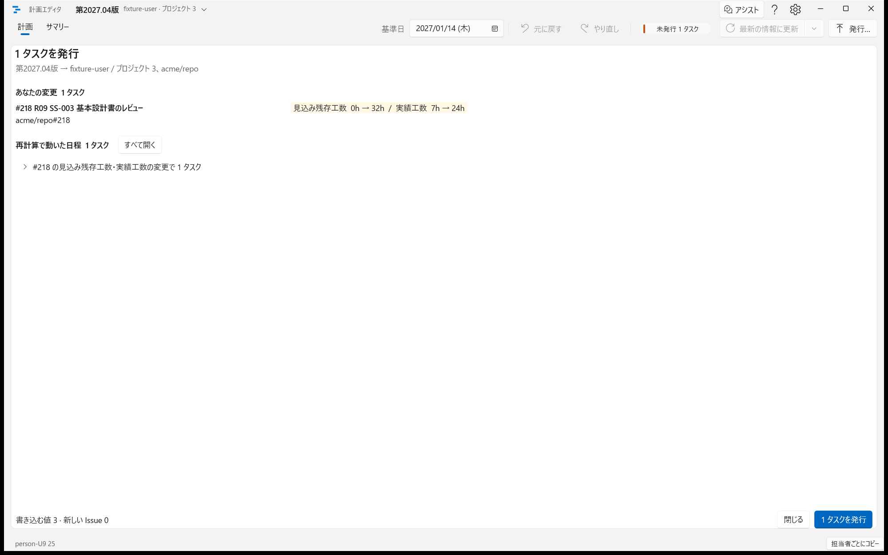

**発行**でタスク・列・変更前 → 変更後を確認し、既存フィールドの競合は **この PC の値にする**または **GitHub の値にする**で解決します。**発行する**を押すまで GitHub には書き込みません。 一覧の上に書き込み先のプロジェクト名・所有者・番号と、書き込むタスク数が表示されます。強調された **発行する**で確定します。**閉じる**で計画に戻っても未発行の編集は残ります。発行は計画を最新の情報に更新しません。他の人の変更は **最新の情報に更新**で取り込みます。書き込む変更も再開する発行・失敗もなければ **発行する**は無効です。中断・一部失敗した発行は、改めて **発行する**で確認して再開できます。失敗や未確認の説明だけのタスクは、書き込むタスク数には含めません。成功後は「N タスクを発行しました（H:mm）」が残り、次に変更を確定するか、更新・GitHub の状態に戻す・プロジェクト切り替えを行うと消えます。レビューを閉じて開き直しても残りますが、再起動後には残りません。一部が失敗した場合はタスクごとの失敗理由を確認します。発行を始めるとレビューが進捗パネルに切り替わり、処理が終わるまでレビューを閉じたり開き直したりする操作はできません。

基準日が今日より前なら、発行の確認に「基準日 … は今日より前です。」と琥珀色で表示します。今日の進捗を取り込むには **最新の情報に更新**を使います。意図して過去の基準日を選んでいる場合は、そのまま発行できます。確認の日付は計画の値で、基準日と同じ年なら年を省きます。

GitHub から削除・除外されたタスクの競合は、破棄するか新しいタスクとしてコピーするかを選びます。暗黙に Issue を再作成することはありません。GitHub で削除された追加フィールドへの編集は、レビューで **編集を破棄**できます。

## GitHub の状態に戻す

**最新の情報に更新**の右の **▾** から **GitHub の状態に戻す…** を選びます。プロジェクト全体を読み直し、入力した変更、新しく追加した未発行のタスク、競合の選択をすべて破棄します。Issue ごとの破棄はありません。GitHub への書き込みや新規 Issue の作成は行いません。

確認画面で、破棄するタスク数と入力した変更・日程が変わったタスクの内訳、新規タスク数を確認します。基準日が今日でなければ、今日になることも表示します。既定のボタンは **キャンセル** です。**GitHub の状態に戻す** を押すと取得を開始します。発行結果が未確認の間は使えません。取得に失敗した場合や採用前に **中止** した場合、計画は変わりません。

完了後は **未発行 0 タスク** となり、日程は GitHub の値をそのまま表示します。**基準日**は読み直した当日になります。稼働率、上限工数、休日、列、担当者、プロジェクトの開始日・終了日などのローカル設定は保持します。次に計画を編集すると、その編集が影響するタスクと後続だけを計算し直します。

最初の取り込みのあとも、**GitHub の状態に戻す** のあとも、日付は GitHub の値のままで、自動で計算し直すことはありません。日付が動くのは、そのタスクを自分で編集したときだけです。要求事項は件数に含みません。

戻したあとでも **元に戻す** を1回押すと、破棄した編集と新規タスクが、最新の GitHub の値に対する未発行の変更として戻ります。**やり直し**で再度破棄できます。未発行が0でも、このコマンドで読み直して日程を GitHub の値に戻せます。

## サマリーと担当者の確認

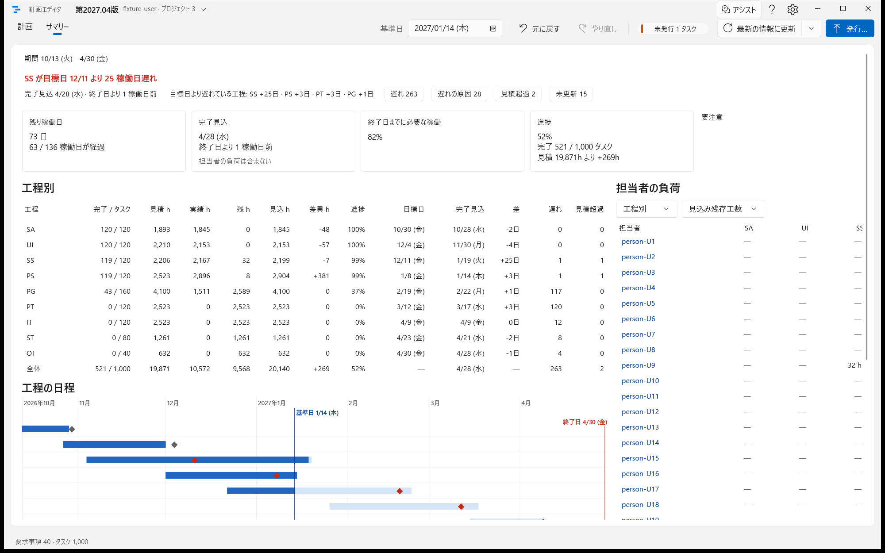

**サマリー**は読み取り専用です。基準日時点の残り稼働日、完了見込、終了日までに必要な稼働、進捗、要注意タスクを確認します。終了日がなければ **設定を開く** で期間を設定します。完了見込は先行関係と見込み残存工数から計算し、担当者の負荷は含みません。日程のないタスク（工数も日付もない挿入行など）は除き、その数を「（日程なし N タスクを除く）」と添えます。必要な稼働が100%を超える場合は「超過」と表示します。

工程別の集計と日程、担当者 × 工程を比較できます。セルの表示を見込み残存工数・見込工数・進捗・期限超過に切り替え、月別では負荷率、超過日数、最大日次負荷を確認します。工数未入力のタスクは除外件数を明記し、既知の値だけを集計します。進捗は実績÷見込、差異は見込−見積です。 割合は整数で表示し、100%を超える値は切り上げます。タスクのない工程セルや配分のない月は「–」です。

工程行やセルを選ぶと選択箇所が強調され、対象タスクの詳細と絞り込みボタンが見える位置へ移動します。詳細のIDは計画のIDと同じです。要注意の件数は、計画をその対象タスクに直接絞り込みます。**この N タスクで計画を絞り込む** で計画に移り、先頭の対象タスクを選択します。件数を確認して修正できます。タイトルの絞り込みを消すと全体に戻ります。稼働率と上限工数は設定の **担当者** で編集します。稼働可能は稼働率×残り稼働日×8hで、上限工数がある場合は上限工数−実績（最低0）を超えません。

詳細の状態欄は、期限超過・予定より遅れ・見積超過・残 0・未完了・完了など、当てはまる状態だけを表示します。通常の未完了タスクは空欄です。長い説明はツールチップで全文を確認できます。詳細はページと一緒に縦スクロールします。200件を超える場合は先頭200件と残り件数を表示し、**この N タスクで計画を絞り込む** で対象の全件を確認できます。

### 担当者ごとに見る

現在の担当者の表示は **サマリー**内の **担当者 × 工程**です。このプロジェクトでタスクに割り当てられている人だけを表示します。**工程別**で工程ごとの見込み残存工数などを比較し、**月別**へ切り替えると負荷率・超過日数・最大日次負荷を確認できます。担当者を自動で割り当て直す機能はありません。

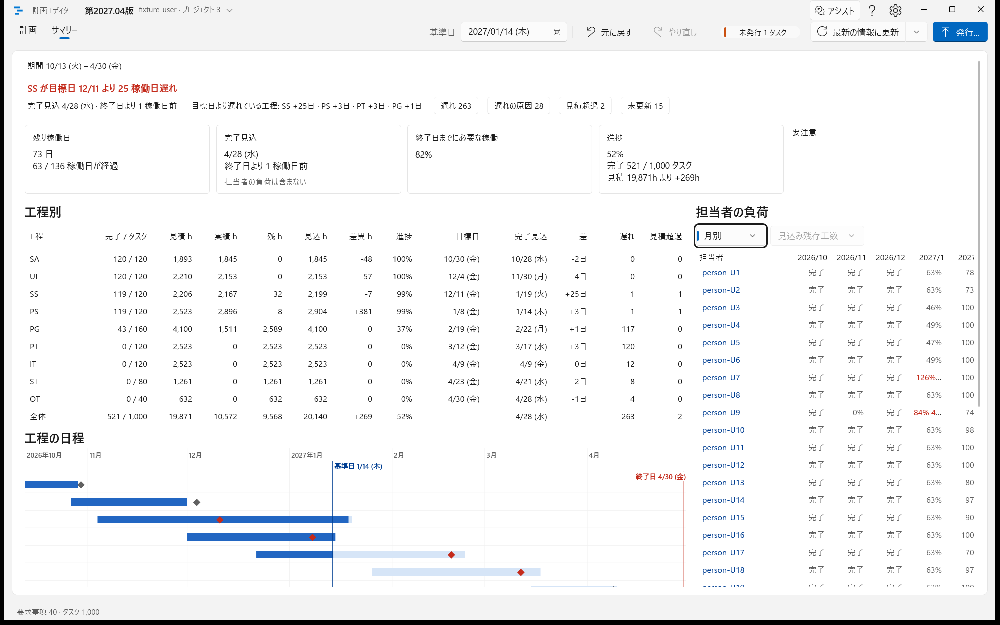

### マイルストーンの目標日と完了見込

GitHub のマイルストーンの期日を目標日として、ガントの ◆ とサマリーで確認できます。◆ は灰色で示し、目標日を過ぎても工程が終わっていないときは赤、完了見込が目標日より遅ければ稼働日数の差を表示します。◆ を選ぶと、その目標日を過ぎるタスクだけを計画に表示します。同じ目標日に複数ある場合は、メニューで名前・完了見込・差を確認して対象を選びます。キーボードでも選択できます。遅れるタスクがなければ絞り込みは変わりません。全期間はマイルストーンの目標日も含めます。サマリーのマイルストーンを選ぶと詳細に遅れるタスクが表示されます。

## 設定

**設定**を開きます。入力を確定すると自動保存され、その設定が影響するタスクが計算し直されます。テキスト入力は別のコントロールへ移ると確定します。**元に戻す**で一操作ずつ取り消せます。

### 期間

**期間**：任意の開始日・終了日を yyyy-MM-dd または yyyy/M/d で指定します（表示は yyyy-MM-dd）。終了日が開始日より前なら保存できません。終了日は日程計算を制限しません。

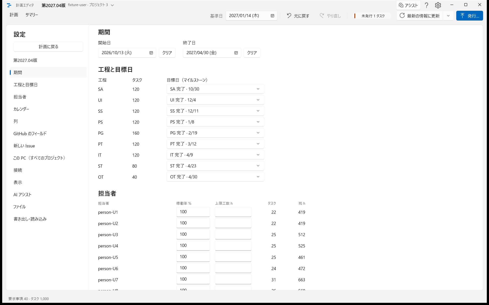

### 工程とマイルストーン

**工程**：割り当てたフィールドの選択肢とタスク数を確認します。未設定なら「GitHub のフィールド」で既存の単一選択フィールドを割り当てます。工程のフィールドを自動作成することはありません。

設定の「工程」の **目標日（マイルストーン）** でマイルストーンを対応させると、工程別の目標日と完了見込の差、工程の日程の ◆ を確認できます。「なし」なら目標日は表示しません。目標日は GitHub のマイルストーンの期日で、GitHub で管理します。Issue の所属はシートのマイルストーン列で編集して発行できます。マイルストーンはタスクの日程を動かしません。同名のマイルストーンはリポジトリをまたいでまとめ、目標日が異なる場合は最も遅い日を使って「目標日がリポジトリで異なります」と注記します。

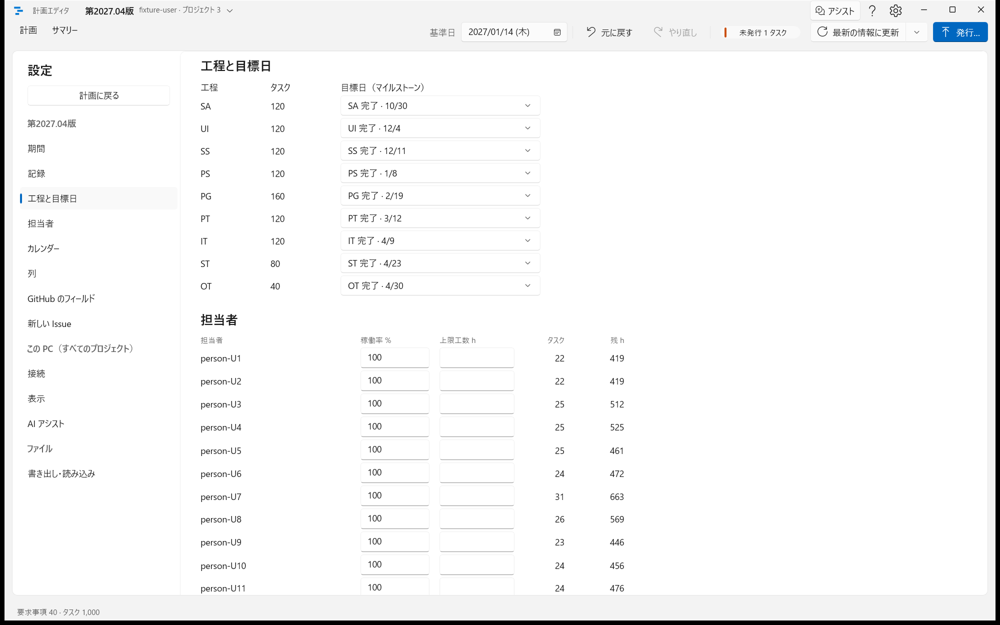

### カレンダー

**カレンダー**：月–金の 09:00–13:00 / 14:00–18:00、内蔵の日本の祝日（2025–2027）を使います。祝日の一覧を展開できます。**祝日CSVを読み込む**では内閣府形式の UTF-8 または Shift-JIS の CSV を選択します。会社休日はカレンダーで日付を選んで **追加**します。取り消す日は一覧で選択して **削除**します。同じ日の重複追加はありません。

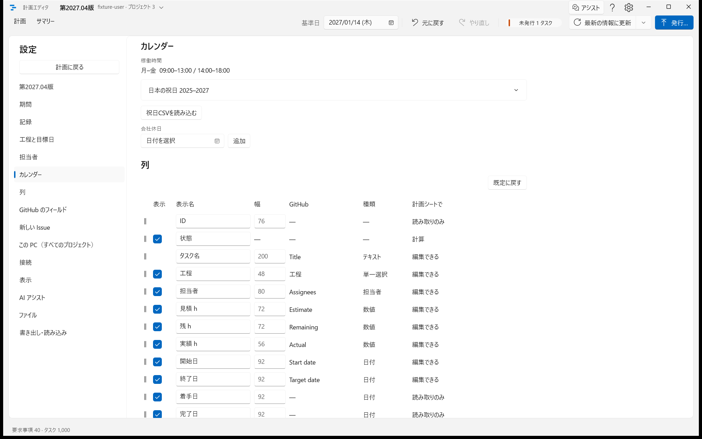

### 担当者の稼働率と上限工数

**担当者**：このプロジェクトの稼働率と上限工数 h を設定します。このプロジェクトでタスクに割り当てられている人だけを表示します。担当から外れた人は一覧に出ませんが、稼働率と上限工数の設定は残り、割り当て直すと同じ値に戻ります。稼働率の初期値は 100% で、0% は指定できません。上限工数は空欄にできます。入力が不正な場合は、その担当者の欄に戻って理由を表示します。IMEの変換確定だけでは設定を確定しません。

個人休日は設定しません。担当者ごとの設定は名前と稼働率、任意の上限工数 h を表示し、日程と稼働可能時間にはプロジェクト共通の稼働日を使います。個人休日を含む古い設定ファイルやローカルデータは読み込めません。移行機能はありません。更新前にローカルの変更を発行または破棄し、新しいデータ保存先でプロジェクトを開いてください。タスクの 担当者 に、まだこのプロジェクトにいない人のログインを入力すると、そのリポジトリで割り当てられる人かを GitHub に1回だけ確認してから設定します。確認中は「担当者 ... を確認しています…」と表示し、入力した文字はセルに残ります。確認できないときはセルに理由が表示され、計画は変更されません。Escape を押すと確認を取り消せます。

### 表示列

シートの **表示列** から設定の **計画シートの列** を開きます。入力エラーがある場合は、セルを修正してから開きます。設定上部の **戻る** はスクロールしても表示されます。期間・工程の後にある表で、表示する列、表示名、GitHub の元フィールド、種類、計画シートで編集できるかを確認します。表示名を空欄にすると既定名に戻ります。**幅** には列の幅をピクセルで入力でき（40〜800）、空欄にすると既定の幅に戻ります。ID とタスク名は常に表示します。ハンドルのドラッグまたは **上へ**・**下へ** の矢印ボタンで順序を変更し、見出し右側の **既定に戻す** で表示・順序・名前・幅をまとめて戻します。各操作は **元に戻す** で取り消せます。列の設定はプロジェクトごとに保存され、設定の書き出し・読み込みにも含まれます。

追加したテキスト・数値・日付・単一選択、ラベル、マイルストーンはタスク行で編集して **発行** できます。単一選択とマイルストーンは既存名、ラベルはそのリポジトリの既存名をカンマで区切って入力します。未知の名前は登録されず、候補があれば候補を示すエラーになります。リポジトリにラベルやマイルストーンがない場合は GitHub で作成します。単一選択の候補がない場合は GitHub のプロジェクト設定で選択肢を追加します。リポジトリとイテレーション、要求事項行は読み取り専用です。列を非表示にしても値と未発行の編集は残ります。

表示していない列の値もプロジェクトの取得時に読み込みます。表示を切り替えるための再取得は不要です。見出しにマウスを置くと GitHub のフィールド名を確認できます。標準列に割り当てたフィールドは追加列には現れません。未発行の追加列編集があるフィールドを標準列へ割り当てるには、その編集を発行するか元に戻してください。

GitHub で追加フィールドが削除された場合、未編集の値は更新時に取り除かれます。未発行の編集があれば発行レビューに値を残し、**編集を破棄** で取り除けます。そのフィールドへの送信は行わず、他の変更は発行できます。リポジトリとイテレーションも、表示値をコピーできます。

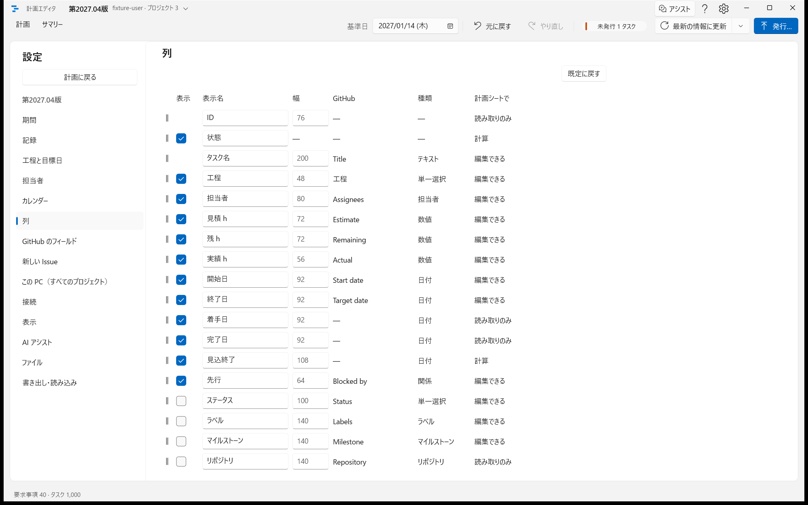

### GitHub のフィールドと新規 Issue の作成先

**GitHub のフィールド**：各入力欄の見出しは見積工数、見込み残存工数、実績工数、開始日、終了日、工程です。選択肢と選択済みのフィールド名は GitHub 上の名前をそのまま表示します。Estimate、Remaining、Actual、Start date、Target date、工程を名前と型で自動対応します。選択を変更した場合は **最新の情報に更新**で新しい列の値を取得します。対応が曖昧な列は未設定になります。

**新規 Issue の作成先**：新規タスクの作成先を owner/repository で指定します。

計画対象外の項目がある場合は、「計画対象外: ドラフト n 件・プルリクエスト n 件・参照できない項目 n 件」のうち 1 件以上ある項目を設定ページの末尾に表示します。

### 設定の書き出し・読み込み

**設定を書き出す**で JSON を保存し、別の PC で同じプロジェクトを開いて **設定を読み込む**と、同じ設定を使えます。

## Issue の詳細

計画で行を選び、シート上の選択行の表示の右にある **詳細**、タイトルバーの **詳細**、またはセルを編集中でないときに **Ctrl+I** を押すと、右側でその Issue の本文と最近5件のコメントを読めます。もう一度押すと閉じます。二つの **詳細** ボタンは同じ状態を表します。選択行に追従し、行の選択だけで開閉はしません。**アシスト**とは同時に開きません。サマリーや設定では隠れ、計画に戻ると再び表示します。

**再読み込み**で選択中の Issue を取り直せます。**GitHub で開く**や本文・コメントのリンクはブラウザーで開きます。GitHub に未作成のタスクは、発行後に本文を表示できます。

### Issue の本文を編集して発行する

**本文を編集** を押すと、本文が Markdown のまま編集欄になります。日本語入力の確定や Enter での改行はそのまま使えます。編集中はコメントを隠し、ほかの行を選んでも詳細はこの Issue のままです。書き終えたら **本文を発行**（Ctrl+Enter）で、この Issue の本文だけを GitHub に書き込みます。右上の **発行…** とは別の操作です。未発行の件数や **元に戻す** には含まれず、セルの入力途中の内容にも影響しません。タイトルやコメントは GitHub で編集してください。

発行の直前に GitHub の本文を読み直します。編集を始めた後に GitHub で本文が変わっていた場合は書き込まず、**上書きして発行** と **GitHub の本文に戻す** を選べます。発行できなかった場合は編集内容を残したまま **再試行** できます。

**キャンセル**（Esc）、詳細を閉じる、プロジェクトの切り替え、アプリの終了のときに本文を変えていれば、変更を破棄するか確認します。サマリーや設定に移っても編集内容は残ります。アプリを終了すると編集内容は残りません。編集する権限がない Issue では **本文を編集** を押せません。

F6 はシート → コマンド行 → 詳細のヘッダー → シート、Shift+F6 は逆順です。Tab でボタンや本文へ移り、本文内はキーボードでスクロールできます。本文内では F6・Shift+F6・Ctrl+I は使えません。Shift+Tab で本文内のリンクを逆にたどるとヘッダーへ戻れます。最後のリンクから Tab を押してもヘッダーへ戻ります。ヘッダーで F6 を押すとシートへ、Shift+F6 を押すとコマンド行へ移ります。セルを編集中でなければ、ヘッダーの Ctrl+I で詳細を閉じてシートへ戻れます。表示部品を使えない場合は、選択してコピーできる Markdown のまま表示します。

## AI アシスト

開いている計画について「遅れている理由は？」「負荷が上限を超えている担当者は？」と質問したり、担当者や工数の変更を提案してもらえます。初期設定は **使わない**です。利用しなくても通常の計画・更新・発行はできます。

### 接続を設定する

**設定**の **AI アシスト（この PC の全プロジェクト共通）**を開きます。この設定は、この PC のすべてのプロジェクトに共通です。プロジェクトの設定ファイルの書き出し・読み込みや **元に戻す**には含まれません。

- **GitHub Copilot**: アプリで接続中の gh アカウントを使います。モデルが空なら `auto` が入り、そのまま **接続を確認**できます。モデルは変更でき、確認後は **利用できるモデル**からも選べます。別のアカウントと判定された場合は gh のログインを確認してください。
- **API キー（BYOK）**: **種類**、**エンドポイント URL**、**モデル**を入力します。OpenAI 互換では **API 形式**も選びます。必要なサービスだけ **会話 ID ヘッダー**を指定します（OpenCode Go の例: `x-opencode-session`）。**API キー**に入力して **登録**を押し、**接続を確認**します。

キーは Windows 資格情報マネージャーに保存され、画面では **登録済み**と表示します。**削除**で消去できます。エンドポイントを変更してもキーは保持します。モデルや URL に不備がある間は理由が表示され、設定を保存しません。**戻る**で元の画面へ戻れます。

### 質問と参照したタスク

タイトルバーの **アシスト**を押すと、計画またはサマリーの右にペインが開きます。質問を入力して **送信**または Enter で送ります。Shift+Enter は改行、日本語変換の確定だけでは送信しません。**選択中**のタスクは質問の文脈として送られ、チップを押すと外せます。

回答は順に表示されます。**参照したタスク**は、アシストが計画から実際に読んだタスクです。リンクを押すと計画に移り、そのタスクを選択します。回答中も計画は編集できます。**停止**で応答を止め、**新しい会話**で会話をやり直せます。プロジェクト・接続アカウント・アシスト設定を変えると会話を終了し、再起動後には復元しません。

### 提案を確認して適用する

変更を頼むと、**変更の提案**にタスク、項目、現在の値、提案する値と、この提案で日程が変わるタスクの件数・先頭10件が表示されます。件数は、その編集が影響するタスクと後続を計算した結果です。内容を確認して **適用**を押すと、この PC の計画に一つの操作として反映します。**元に戻す**一回で提案全体を戻せます。不要なら **破棄**します。

提案後に計画を編集・更新した場合、その提案は適用できません。現在の計画について、もう一度依頼してください。アシストが自動で適用・タスクの追加削除・設定変更・GitHub への発行をすることはありません。採用した変更の発行は、通常どおり **発行…**から確認して行います。

### 送信する情報

質問文、選択中のタスクの識別子、回答に必要な計画の検索結果・タスク情報・サマリー・マニュアルの該当部分を、設定したサービスへ送信します。計画には未発行の編集も含みます。タスク名、担当者、工程、工数、日程、先行関係などが対象です。Issue の本文・コメント、他のプロジェクト、PC のファイルは読みません。接続確認では計画を送りません。API キーは接続にだけ使い、計画や設定ファイル・エクスポートには保存しません。

## CSV から追加・CSV に書き出し

### CSV から追加

1. [新規タスク用テンプレート](templates/new-tasks.csv)をExcelなどで開き、1行に1タスクを記入します。アプリの出力先にも `templates/new-tasks.csv` があります。
2. シートのツールバーの **…** にある **CSV から追加…**でファイルを選びます。UTF-8（BOMの有無を問わない）とShift-JISに対応します。
3. エラーがあれば表示された行を修正し、**CSVを選び直す**を押します。エラーが残る間は1件も追加されません。
4. 未発行のタスクと計算された日程を確認します。**元に戻す**で一括追加全体を取り消せます。GitHubに反映するには **発行**を使います。

| 列 | 入力 |
| --- | --- |
| キー | ファイル内で重複しない識別名。例 `design`。GitHubには送信しません。 |
| タイトル | 必須のタスク名。 |
| 見積 | h。例 `8`、`1.5`。空欄は未入力、`0`はマイルストーン。列自体は必須です。 |
| 担当者 | GitHubのログイン名。複数なら `;` 区切り。空欄は未割当。 |
| 先行タスク | キー、既存Issueの `#123`、または `owner/repository#123`。複数なら `;` 区切り。 |
| 親 | 親のキーまたは既存Issueの参照を1つ。 |
| 開始日 | 任意。新しいタスクの開始日。`2026-10-13` または `2026/10/13`。 |
| リポジトリ | 任意。`owner/repository`。空欄ならプロジェクト設定の既定値。 |

既存Issueは開いているプロジェクト内のものを指定します。シートのID列とIssue番号は別です。参照はファイル内のキーを優先するため、数値キーと区別するときは `#` を付けます。担当者なしのタスクはプロジェクトカレンダーの稼働率100%で計算します。親の見積工数と日程は子タスクから集計します。

同じファイルを再び選ぶと重複追加の確認が出ます。判定はファイル全体のバイト列によるため、内容や文字コードを変えたファイルは別扱いです。上限は5 MiB・10,000タスクです。

### CSV に書き出し

計画を開き、シートのツールバーの **…** → **CSV に書き出し…** で保存先を選びます。入力中のセルは確定してから書き出され、入力エラーがあれば修正が必要です。キャンセルするとファイルは作成されません。

絞り込みや折りたたみにかかわらず、要求事項とタスクの全行を計画順で出力します。表示中の列と表示名に加え、要求事項（その行が属する最上位の行の名前。最上位の行は空欄）・リポジトリ・Issue 番号・URL・**未発行** が入ります。Excel では要求事項の列で絞り込みや集計ができます。値はこの PC の現在の計画です。未発行には新しいタスクなら **新規**、変更済みなら発行レビューと同じ項目名が入り、変更がなければ空欄になります。

保存した CSV を Excel で開けます（日本語を扱える UTF-8 BOM 付き）。工数は単位なしの数値、日付は `yyyy-MM-dd` です。取得できない値は **取得できません** と表示します。数式として解釈され得るテキストの先頭には安全のため `'` が付きます。書き出し完了時に行数が表示されます。GitHub への書き込みや Excel のインストールは必要ありません。この CSV は分析用で、新規タスク追加用テンプレートとは形式が異なります。

## 困ったとき

### 接続できない・一覧に出ない

gh.exe のパス、接続先、gh の保存済みアカウントと対象プロジェクトへの権限を確認します。画面に出た理由に従って接続をやり直してください。企業環境の認証・権限は、その環境で確認が必要です。

### 更新中・発行中の操作

プロジェクトを開くとき・更新中・発行中は、計画の上に進捗パネルが表示され、処理名と現在の工程、取得件数や書き込み件数（わかる場合）が表示されます。処理が終わるまで計画は操作できません。URL で開く場合も **プロジェクトを確認** の段階から進捗パネルの対象となり、中止すると元の画面に戻ります。確認中は入力や別の「開く」操作はできません。プロジェクトを選んで開くときは選んだ名前がすぐに表示され、短時間で開ける場合は進捗パネルを表示しません。開く操作と更新は、取得した内容の採用前まで **中止** で操作前の状態に戻れます。ただし、更新中に作成済みと確認できた Issue と行の対応は保存され、中止しても残ります。それ以外の計画・履歴は変わりません。**日程を計算** に進むと中止ボタンは表示されたまま無効になり、処理の完了を待ちます。発行には中止ボタンはありません。ウィンドウを閉じると発行は中断され、次に **発行** すると残りを再開します（パネルの「閉じても、次の発行で続きから再開します。」）。**中止** の説明はボタンにマウスを置くと表示します。ローカルの編集・元に戻す・設定の操作では、このパネルは出ません。

### エラーと GitHub で未確認

更新・発行・保存に失敗すると、作業カード下部のエラー通知（InfoBar）に理由と再試行ボタンが出ます。更新の **再試行** は再取得し、発行の **再試行** はレビューを開き直します。再試行だけでは発行せず、改めて **発行する**で確認します。保存失敗は **保存を再試行**で回復します。保存が成功すると保存失敗の通知は消えます。

別のウィンドウや別のアプリが同じ計画を保存すると、このウィンドウの保存は拒否されます。通知にその理由が出て、**読み直して編集を適用**（保存されている計画を読み込み、このウィンドウの未保存の編集を重ねて保存します）と **コピーとして保存…**（このウィンドウの内容を選んだファイルに保存し、保存されている計画は変えません）を選べます。**保存を再試行**しても解決しません。読み直して適用できない場合は、理由を表示して編集を保持したままにします。

発行に失敗したタスクを選択すると、失敗の理由を確認できます。修正後に **発行**で残った変更を送ります。**GitHub で未確認**は **最新の情報に更新**で結果を確認してください。中断後は再起動して同じプロジェクトを開き、更新または発行で続けられます。元に戻す操作はローカルだけを変更し、GitHub を戻す場合も改めて発行します。

保存失敗時は画面の理由を確認し、保存先を直して **保存を再試行**します。保存できない間も編集は保持され、ウィンドウを閉じるときは理由と選択肢（**読み直して編集を適用**／**コピーとして保存…**／**編集を破棄して閉じる**／**閉じない**）が出ます。**編集を破棄して閉じる**と未保存の変更は失われます。入力が不正な場合はその入力を直してください。理由を表示した後もプロジェクト選択は開けますが、プロジェクトを切り替える操作は拒否され、修正する入力欄に戻ります。通常の設定変更や **元に戻す**は GitHub に書き込みません。

### 終了・再起動とデータの保存先

**最新の情報に更新**はプロジェクト全体を取得します。未発行の編集はプロジェクトごとに保持されます。終了時には実行中の取得を中止して保存完了を待ち、次回接続後に選択していたプロジェクトを開きます。以前のデータ形式は読み込みません。

計画を編集するウィンドウは1つです。起動中にアプリをもう一度起動しても2つ目のウィンドウは開かず、すでに開いているウィンドウが前面に戻ります（最小化されていれば復元します）。計画を保存できないまま終了した場合は、選んだ内容だけが残ります。

通常の保存先は `%LOCALAPPDATA%\GhProjectsBoards\Registrations` です。プロジェクトと接続アカウント・接続先ごとに作業を保持します。未発行の作業がある間は保存先のファイルを削除・編集しないでください。設定の書き出しは設定だけで、未発行のタスクの控えではありません。

ヘルプは同梱の `マニュアル.md` から一時 HTML を作って既定のアプリで開きます。画像が表示されない場合は配布フォルダーの `manual/images` が揃っているか確認してください。HTML の作成に失敗した場合は Markdown を開きます（関連付けがなければメモ帳）。「マニュアルが見つかりません」と出た場合は、表示された場所に `マニュアル.md` があるか確認し、配布フォルダー全体を再展開してください。

## 開発者向け

評価データの起動・再開、sandbox、画像の再生成は[評価手順](https://github.com/fukuda-yuki/gh-projects-boards/blob/main/evaluation/README.md)と[画像取得計画](https://github.com/fukuda-yuki/gh-projects-boards/blob/main/docs/manual/README.md)を参照してください。

## 行の移動と階層順

ID をクリックすると行全体を選択し、Shift+クリックで連続する行を選択できます。セル範囲の行も移動対象です。選択内の ID をドラッグし、挿入線で離すと、折りたたまれた子も一緒に移動します。Esc または移動できない場所で離すと取り消します。

Alt+Shift+↑ / Alt+Shift+↓、その他メニューの **上へ移動** / **下へ移動** も使えます。同じ親のタスクだけを並べ替えられます。親の変更には **インデント** / **アウトデント** を使います。絞り込み中は移動できません。

親子が離れている場合は **階層順に並べ替え** でまとめます。読み込みだけでは並べ替えません。各操作は1回で元に戻せ、**発行** まで GitHub に送信しません。行の移動で ID（Issue 番号）は変わりません。ID 欄の左の小さな数字が現在の行位置です。動かした行（子タスクを含む）だけが未発行になり、押し出されて位置がずれただけの行は数えません。発行すると、動かした行の並び順を GitHub の Project に反映します。

CSV は親から子の順に配置し、兄弟は CSV 内の順序を保ちます。後の行の親も参照でき、キーの振り直しは不要です。既存の親の子はその配下の末尾に追加します。行挿入は挿入先の親を引き継ぎ、末尾の空行は最上位になります。アウトデントは元の親の配下全体の後ろへ移動し、残る兄弟の親は変えません。
